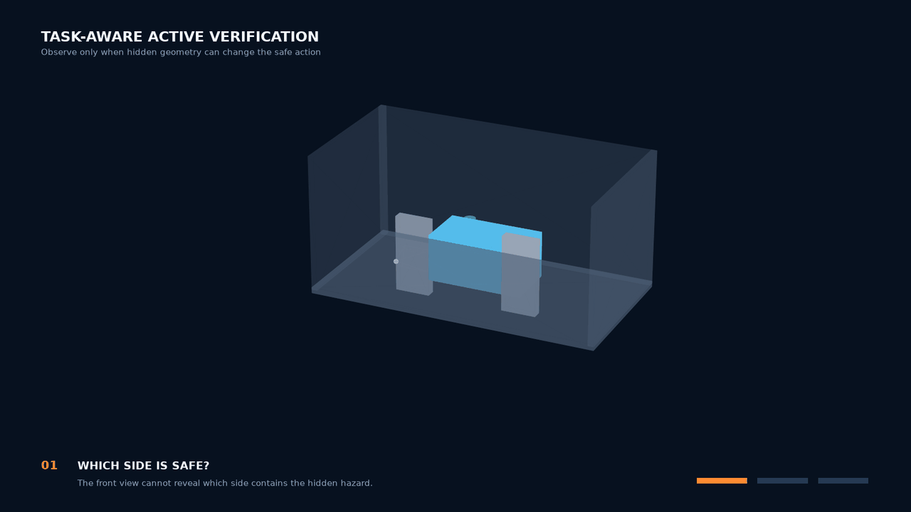
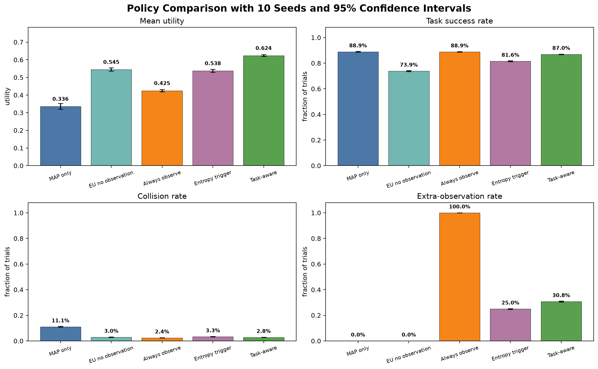

# Task-Aware Active Verification under Occlusion

A compact research demo for studying **when a robot should act, observe from a
new viewpoint, or stop** when the geometry of an object is partially occluded.

The central idea is task sufficiency: the robot does not always need to recover
the complete object shape. It should acquire an additional view only when the
remaining geometric uncertainty can change the safest task action.



## What the demo shows

The simulated robot performs a closed decision loop:

1. obtain a partial RGB-D observation;
2. maintain several plausible hidden-shape hypotheses;
3. derive grasp feasibility from geometry/corridor intersections;
4. estimate the decision value of candidate camera views;
5. update the belief after a selected observation;
6. execute a safe action once the unresolved hypotheses agree on that action.

In the illustrated shelf-picking example, the front view cannot distinguish a
left-side hazard, a right-side hazard, and no side hazard. The system selects a
side view, eliminates the task-incompatible hypothesis, and performs the safe
right grasp without requiring complete shape identification.

## Main result

The controlled policy experiment compares five strategies over 10 independent
seeds and 50,000 synthetic test scenarios. The task-aware policy achieves the
highest mean utility while observing selectively rather than in every trial.

| Policy | Mean utility | Success | Collision | Extra observations |
|---|---:|---:|---:|---:|
| MAP only | 0.336 | 88.9% | 11.1% | 0.0% |
| Expected utility, no observation | 0.545 | 73.9% | 3.0% | 0.0% |
| Always observe | 0.425 | 88.9% | 2.4% | 100.0% |
| Entropy trigger | 0.538 | 81.6% | 3.3% | 25.0% |
| **Task-aware** | **0.624** | **87.0%** | **2.8%** | **30.8%** |



See [EXPERIMENT_PROTOCOL.md](EXPERIMENT_PROTOCOL.md) for the evaluation design,
validation/test split, utility model, confidence intervals, and limitations.

## Repository guide

The public demo keeps only the two scripts needed to understand and reproduce
the main result:

| Script | Purpose |
|---|---|
| `demo_active_verification.py` | Run the geometry-driven active-verification demo and generate the animation. |
| `evaluate_policy.py` | Evaluate the five policies over multiple random seeds with 95% confidence intervals. |

## Quick start

Python 3.11 is recommended.

```bash
conda create -n spatial-belief python=3.11 -y
conda activate spatial-belief
python -m pip install -r requirements.txt
```

Run the main research demo without opening interactive windows:

```bash
python demo_active_verification.py --no-show
```

This regenerates the figures, CSV traces, 1080p MP4, and animated GIF under
`outputs/`. To skip video generation while iterating on the static figures:

```bash
python demo_active_verification.py --no-show --no-gif
```

Run the controlled policy evaluation:

```bash
python evaluate_policy.py --no-show
```

## Selected outputs

- `outputs/research_demo_active_verification.gif` — compact animated overview;
- `outputs/research_demo_active_verification_1080p.mp4` — 1600×900, 24 fps video;
- `outputs/research_demo_hero_figure.png` — complete closed-loop figure;
- `outputs/credible_policy_comparison.png` — multi-seed policy comparison;
- `outputs/credible_policy_summary.csv` — numerical policy results.

## Scope and limitations

This repository is a **synthetic research prototype**, not a physical-robot
deployment. It uses controlled parametric geometry, Open3D ray casting, a
hand-designed utility model, and simulated sensing noise. It does not yet use a
learned 3D completion network, a motion planner, contact physics, or real sensor
data. The current contribution is the transparent connection between partial
geometry, belief, task feasibility, view value, and action selection.

## 中文简介

该项目演示机器人在物体被遮挡时，如何根据任务后果决定“立即行动、主动换视角，
还是安全停止”。核心不是强行恢复完整三维形状，而是只获取足以支持安全任务决策的
信息。目前结果属于可复现的合成仿真实验，尚不是实体机器人实验。

